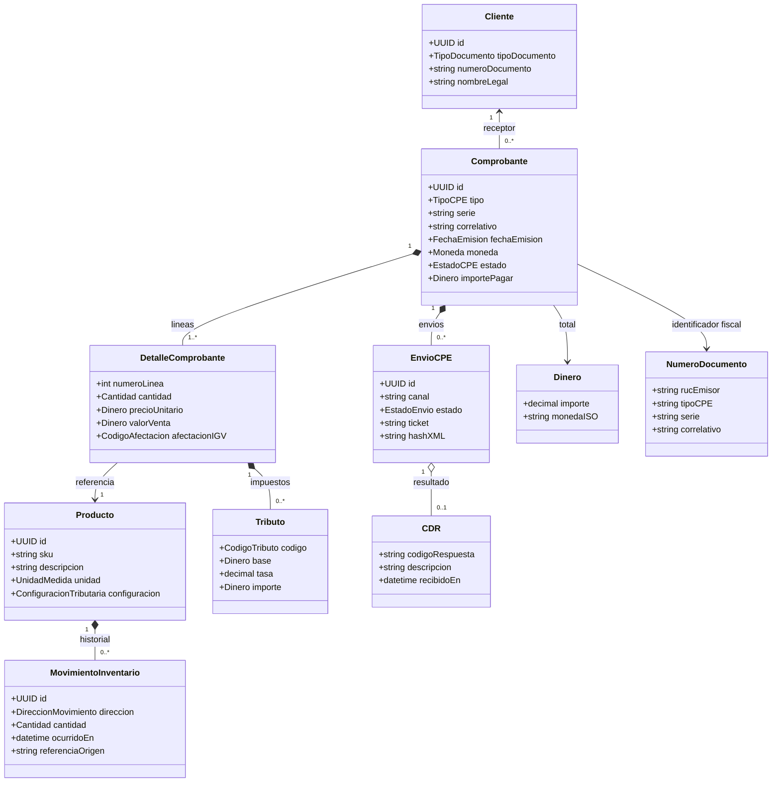

# Hito 3: Modelo de dominio, reglas de negocio y DTOs

> **Estado:** modelo conceptual de diseño. Los valores normativos variables y los puntos sin fuente local se marcan **POR VERIFICAR**.  
> **Límite:** este artefacto describe contratos y reglas; no implementa lógica ejecutable.

## 1. Contextos y agregados

- **Facturación:** agregado `Comprobante`, raíz que protege identidad, líneas, importes calculados, referencias y ciclo de emisión. `DetalleComprobante` es entidad de línea; `Dinero`, `IdentificacionFiscal`, `NumeroDocumento`, `Tributo` y `EstadoEnvio` son value objects.
- **Clientes:** agregado `Cliente`, con tipo/número de identificación, razón social/nombres y datos de contacto/domicilio versionables.
- **Catálogo:** agregado `Producto`, con SKU, descripción, unidad, precio de lista y configuración tributaria vigente por fecha. El producto no conserva como verdad una tasa tributaria histórica sin vigencia.
- **Inventario:** agregado `InventarioProducto` cuya existencia se deriva de movimientos; `MovimientoInventario` registra entrada/salida, cantidad, origen y auditoría.
- **Integración electrónica:** `EnvioCPE`/`RespuestaRecepcion` representan intentos, ticket, CDR y resultado; la respuesta no reemplaza ni muta el XML firmado original.

Los identificadores de catálogos se transportan como cadenas para conservar ceros iniciales; su validez se comprueba contra una versión de catálogo registrada. Importes se modelan como decimal exacto más moneda ISO, no como punto flotante binario.

## 2. Reglas matemáticas de cálculo

### 2.1 Notación y orden

Para una línea $i$, sea $q_i$ la cantidad, $p_i$ el precio unitario neto de impuestos, $d_i$ el descuento atribuible, $c_i$ los cargos atribuibles, $b_i$ la base neta y $s_i$ el ISC calculado cuando corresponda.

$$
b_i = (q_i \times p_i) - d_i + c_i
$$

Las reglas de asignación de descuento/cargos, si el precio recibido incluye impuestos, y el tratamiento de operaciones gratuitas dependen del perfil SUNAT y de la política de precios; detalles **POR VERIFICAR**. El motor debe conservar los importes de origen y los resultados intermedios para auditoría.

### 2.2 Base imponible e IGV

Se agrupan líneas por esquema tributario y código de afectación validado. Para una categoría gravada $k$:

$$
B_k = \sum_{i \in k} b_i + \sum_{i \in k} s_i + A_k - D_k
$$

$$
IGV_k = \operatorname{redondeo}(B_k \times r_{IGV})
$$

La tasa general indicada para el diseño es $r_{IGV}=0.18$ (18%). **Fuente:** TUO de la Ley del IGV e ISC, D.S. 055-99-EF, art. 17, y Ley 29666; vigencia, componentes y posibles tasas/regímenes especiales aplicables al emisor/producto al momento de la operación: **POR VERIFICAR** en texto oficial vigente. No aplicar automáticamente 18% a categorías exoneradas, inafectas, exportación o gratuitas; la clasificación debe ser una decisión legal/catálogo, no inferencia del producto.

La inclusión de ISC, cargos y descuentos en la base se determinará de acuerdo con el artículo aplicable del TUO y la naturaleza de la operación. La expresión anterior es el modelo de cálculo para categorías en que legalmente corresponda, no una afirmación universal. Fuente de la definición de base imponible: D.S. 055-99-EF, art. 14; aplicación exacta por escenario **POR VERIFICAR**.

### 2.3 ISC

El ISC depende del bien sujeto, período y sistema de cálculo declarado (Catálogo 08). Sea $m_i$ la base específica definida legalmente, $t_i$ la tasa ad valorem, $u_i$ las unidades imponibles y $f_i$ el monto fijo unitario:

$$
ISC_i =
\begin{cases}
\operatorname{redondeo}(m_i \times t_i), & \text{ad valorem}\\
\operatorname{redondeo}(u_i \times f_i), & \text{monto fijo}\\
\operatorname{redondeo}(g(PVP_i, parámetrosLegales_i)), & \text{precio de venta al público}
\end{cases}
$$

La función $g$, tasas, montos fijos, base, unidades, productos gravados y vigencias se obtendrán de los Apéndices III/IV del TUO de la Ley IGV/ISC (D.S. 055-99-EF, arts. 50–67 y modificatorias) y disposiciones MEF/SUNAT vigentes. No se codifica aquí una fórmula estimada para PVP: **POR VERIFICAR** para cada producto/sistema.

### 2.4 ICBPER

Para bolsas gravadas identificadas en la operación:

$$
ICBPER = N_{bolsas} \times tarifa_{vigente}(fechaEmision)
$$

La tarifa debe estar versionada por fecha y no se fija como constante en este documento. **Fuente:** Ley 30884, art. 12, y reglamentación/modificatorias; valor vigente, supuestos de afectación, registro en XML y tratamiento en bases/totales **POR VERIFICAR** en fuente oficial aplicable. No sumar a bases de IGV ni excluirla de estas por mera convención; ejecutar el tratamiento solo tras confirmar la regla normativa y perfil UBL.

### 2.5 Total y redondeo

El total de salida debe reconciliar con líneas, descuentos/cargos, tributos, anticipos y redondeo según el perfil de documento. La identidad algebraica concreta de cada importe (`LineExtensionAmount`, `TaxExclusiveAmount`, `TaxInclusiveAmount`, `PayableAmount`) se validará contra el perfil UBL/SUNAT antes de cerrar el motor.

**Decisión de diseño provisional, no regla legal:** representar cantidades/importes con decimal de precisión fija; no usar `float`/`double`. Conservar precisión intermedia; redondear de forma determinista (propuesta: mitad alejándose de cero) en los límites de cálculo por línea/subtotal definidos por la guía oficial; serializar la escala que exija el perfil. Número de decimales, etapa exacta, modo de empate y tolerancias **POR VERIFICAR** en guías SUNAT. Si línea y total difieren por redondeo, informar el delta; no ajustar silenciosamente.

### 2.6 Validación de RUC: algoritmo de control

La validación local del dígito de control detecta errores de digitación; no confirma que el RUC exista, esté activo/habido o habilitado para emitir.

1. Exigir 11 caracteres numéricos para ejecutar el control; conservar como texto para mantener ceros si los hubiere.
2. Para los primeros diez dígitos $d_1,\ldots,d_{10}$ aplicar pesos $w=(5,4,3,2,7,6,5,4,3,2)$.
3. Calcular $s=\sum_{i=1}^{10}d_iw_i$, $r=s\bmod 11$, $c=11-r$.
4. Convertir $c=10$ a 0 y $c=11$ a 1; comparar con el dígito 11.

**Estado:** algoritmo propuesto para validación de checksum; fuente procedimental oficial y tratamiento de prefijos/identificadores especiales **POR VERIFICAR** con SUNAT. La aceptación exige además consultar la fuente oficial habilitada según política de datos. Marco de RUC: D. Leg. 943 y RS 210-2004/SUNAT, texto vigente **POR VERIFICAR**.

## 3. Mapeo y saneamiento de datos legados

El archivo fuente, su esquema y ejemplos reales no están disponibles; la correspondencia es provisional y no convierte automáticamente datos históricos en comprobantes electrónicos.

| Campo legado | Destino candidato | Transformación / regla de limpieza | Riesgo y decisión requerida |
|---|---|---|---|
| `fecha` | `Comprobante.fechaEmision` o `MovimientoInventario.ocurridoEn` | Parsear formatos admitidos con configuración explícita de zona horaria; preservar valor bruto y origen; rechazar fechas imposibles. | Determinar si la fecha representa venta, registro o movimiento. Ambiguos a cuarentena. |
| `ingreso` | `MovimientoInventario` dirección `IN` o monto contable separado | Determinar semántica y unidad; validar no negativo; no inferir que el campo es importe ni cantidad hasta revisar muestras. | Definición del legado **POR VERIFICAR**. |
| `salida` | `MovimientoInventario` dirección `OUT` o monto contable separado | Igual tratamiento; vincular SKU, unidad y referencia cuando haya evidencia. | No derivar CPE ni impuestos de movimiento de stock. |
| `producto` | `Producto.sku`/descripción y referencia en líneas/movimientos | Normalizar espacios y codificación sin destruir texto; resolver duplicados por clave comprobada; mapear unidad/categoría solo con catálogo aprobado. | Duplicados o descripciones no identificables se ponen en cuarentena. |
| `nro_documento` | Identificador de documento de origen; opcionalmente `Comprobante.numero` tras verificación | Mantener `numeroOriginal`; clasificar tipo, serie y correlativo solo si fuente y formato lo prueban; vincular al CPE original con evidencia. | Numeraciones informales no son IDs SUNAT válidos por defecto. Nunca fabricar RUC/serie/correlativo. |

### Estrategia para numeraciones informales y calidad

1. Ingerir a área de staging inmutable con ID de lote, fila, archivo, checksum y valores originales.
2. Normalizar solo formatos declarados; almacenar tanto `numeroOriginal` como resultado normalizado y regla aplicada.
3. Clasificar como **verificado** (corroborado con XML/CDR/registro oficial), **mapeable** (con evidencia documental interna) o **cuarentena** (ambiguo, duplicado o incompleto).
4. No asignar una serie tributaria ni correlativo retroactivo para aparentar emisión. Crear un identificador técnico de migración separado del número fiscal.
5. Cargar a dominio solo registros que superen controles de identidad, unidades, fechas, cantidades e integridad referencial; generar informe de rechazados y revisión humana.
6. Conciliar conteos, cantidades y saldos antes/después; cualquier política de corrección y conservación se aprueba con Contabilidad y responsable de datos.

## 4. Contratos JSON Schema

Los DTOs se especifican en `docs/contracts/SCHEMAS/` con JSON Schema Draft 2020-12. Los schemas concretos y sus propiedades canónicas son:

| Archivo | Contrato |
|---|---|
| `customer.schema.json` | Identificación, nombre y datos de cliente. |
| `product.schema.json` | SKU, unidad, precio y claves de clasificación tributaria. |
| `sale.schema.json` | Entrada de emisión; datos de cliente, líneas y referencia, sin estado/total calculado. |
| `invoice.schema.json` | Recurso emitido con ID, tipo/número, estado, totales, cliente y líneas. |
| `invoice-line.schema.json` | Línea de respuesta con importe calculado y desglose tributario. |
| `inventory-movement.schema.json` | Entrada/salida, producto, cantidad, fecha y referencia. |
| `daily-summary.schema.json` | Resumen por fecha/documentos, ticket y estado. |
| `api-error.schema.json` | Error uniforme con código, mensaje, correlación y errores de campo. |

Los catálogos SUNAT se expresan como cadenas (`code`) y no se congelan como enums hasta confirmar la publicación vigente. Fuente tributaria del modelo: TUO IGV/ISC (D.S. 055-99-EF), Ley 29666, Ley 30884; aplicabilidad, tasas y criterios vigentes **POR VERIFICAR** en sección 2.