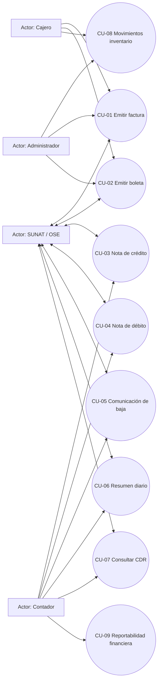

# Hito 2: Casos de uso integrales

> **Alcance:** flujos solicitados para CPE, operación de inventario heredada y reportabilidad.  
> **Base de requisitos:** `docs/compliance/reference/enunciado.md` e instrucción del usuario. Los detalles regulatorios operativos se etiquetan **POR VERIFICAR**.

## 1. Actores

| Actor | Responsabilidad / interacción |
|---|---|
| Cajero | Registra venta, identifica cliente, solicita emisión de factura/boleta y entrega representación del comprobante. |
| Administrador | Mantiene usuarios, series, catálogo de productos y parámetros; autoriza operaciones según permisos. |
| Contador | Revisa comprobantes, notas, bajas, resúmenes y reportes; realiza conciliación y seguimiento de observaciones. |
| SUNAT/OSE | Recibe comprobantes o lotes, procesa y devuelve CDR/estado o ticket conforme al canal habilitado. Operación directa u OSE: **POR VERIFICAR**. |
| Servicio de validación de identidad SUNAT (externo) | Consulta de datos/estado del RUC, si la integración se habilita. Disponibilidad, interfaz y uso permitido: **POR VERIFICAR**. |

## 2. Casos de uso

### CU-01 — Emitir factura electrónica

- **Actor principal:** Cajero. **Colaboradores:** Contador, SUNAT/OSE.
- **Precondiciones:** usuario autenticado y autorizado; emisor y serie configurados; cliente identificado conforme al tipo de comprobante; productos y precios vigentes; conectividad/estrategia de cola definida.
- **Flujo principal:** 1) El cajero registra cliente y líneas. 2) El sistema valida datos, catálogos, existencias y numeración. 3) Calcula importes/tributos por línea y totales. 4) Presenta resumen para confirmar. 5) Reserva correlativo atómicamente. 6) Construye XML UBL 2.1, valida XSD y reglas de perfil. 7) Firma según perfil autorizado. 8) Envía por el canal configurado. 9) Persiste XML/hash, solicitud, respuesta y estado. 10) Presenta el resultado y genera representación imprimible.
- **Alternos/error:** A1 datos inválidos: mostrar errores por campo, no reservar número. A2 falta de stock: impedir emisión o solicitar autorización según política de negocio **POR VERIFICAR**. A3 error XSD/regla SUNAT: no enviar; conservar borrador y diagnóstico. A4 fallo firma: no enviar ni declarar emitido. A5 timeout: estado `SUBMITTED_UNKNOWN`/consulta antes de reintentar para evitar duplicado. A6 rechazo: persistir CDR y motivo; permitir corrección solo mediante flujo legal aplicable. A7 canal offline: dejar en cola solo si se aprueba la política y el plazo legal permite el envío; **POR VERIFICAR**.
- **Postcondiciones:** se conserva una trazabilidad inmutable entre comprobante, correlativo, XML firmado, envío y CDR/resultado; estado refleja el resultado, no solo el intento.

### CU-02 — Emitir boleta electrónica

- **Actor principal:** Cajero. **Colaboradores:** SUNAT/OSE.
- **Precondiciones:** serie B configurada según regla oficial vigente; cliente/receptor y datos requeridos completos; productos y existencias disponibles.
- **Flujo principal:** registrar venta, validar información y Catálogos 01/02/05/06/07/08, calcular importes, reservar correlativo, generar y firmar XML UBL, registrar envío/resultado y emitir representación.
- **Alternos/error:** datos de adquirente opcionales o mínimos no se asumirán; aplicar límites/condiciones del perfil vigente **POR VERIFICAR**. Timeout y rechazo se manejan como en CU-01. Si se agrupa, pasar a CU-06 y correlacionar cada detalle.
- **Postcondiciones:** venta y CPE quedan vinculados; si se agrupa, el registro queda pendiente de asociación al resumen/CDR.

### CU-03 — Emitir nota de crédito

- **Actor principal:** Contador. **Colaboradores:** Administrador, SUNAT/OSE.
- **Precondiciones:** CPE afectado localizable y con estado conocido; motivo/código permitido; usuario autorizado; serie y correlativo disponibles.
- **Flujo principal:** seleccionar documento afectado; elegir motivo y alcance (total/parcial); especificar líneas/importes; validar referencias, signo, impuestos y saldo de modificación; generar documento UBL del tipo correspondiente, firmarlo, enviarlo y registrar CDR.
- **Alternos/error:** referencia inexistente/tipo incompatible, motivo no permitido, suma excede lo afectable, CPE en estado incompatible, firma/transmisión fallida: bloquear o dejar en borrador con causa. No se implementa anulación encubierta mediante modificación de datos.
- **Postcondiciones:** nota ligada al documento original, con traza propia y estado independiente; afectación contable disponible para reportes.
- **Base normativa:** RS 097-2012/SUNAT, anexos aplicables y catálogo de motivos correspondiente; versión/códigos/plazos **POR VERIFICAR**.

### CU-04 — Emitir nota de débito

- **Actor principal:** Contador. **Colaboradores:** Administrador, SUNAT/OSE.
- **Precondiciones:** CPE afectado localizable; motivo autorizado; sustento e importe documentados; serie configurada.
- **Flujo principal:** seleccionar CPE, declarar motivo y partidas de incremento, validar referencias y cálculo tributario, construir UBL DebitNote, firmar, enviar y almacenar CDR/resultado.
- **Alternos/error:** falta sustento, motivo no válido o referencia incompatible: no emitir. Error de integración: conservar estado de envío y consultar antes de reenviar.
- **Postcondiciones:** nota de débito auditable, relacionada al original, sin alterar el XML histórico.
- **Base normativa:** RS 097-2012/SUNAT y anexos/catálogos aplicables; reglas exactas **POR VERIFICAR**.

### CU-05 — Comunicación de baja / anulación

- **Actor principal:** Contador. **Colaboradores:** Administrador, SUNAT/OSE.
- **Precondiciones:** comprobante elegible para baja según tipo, estado y ventana vigente; motivo y autorización registrados.
- **Flujo principal:** localizar CPE; verificar elegibilidad; preparar comunicación con el documento/ítem y motivo requerido; firmar y remitir; registrar ticket, respuesta y resultado; actualizar proyección de estado sin borrar el documento original.
- **Alternos/error:** CPE no elegible, fuera de plazo, ya comunicado o con estado desconocido: impedir duplicidad y escalar. Ticket pendiente: consultar estado, no asumir aceptación. Si el mecanismo normativo correcto es nota de crédito/resumen, derivar al flujo correspondiente.
- **Postcondiciones:** queda un evento de baja y su respuesta enlazados al CPE, preservando auditoría.
- **Base normativa:** RS 097-2012/SUNAT, anexos y modificatorias; elegibilidad, contenido, ventana y método por tipo CPE **POR VERIFICAR**.

### CU-06 — Generar y enviar resumen diario de boletas

- **Actor principal:** Contador. **Colaboradores:** SUNAT/OSE.
- **Precondiciones:** boletas del período clasificadas; cambios/anulaciones registrados; correlativos y totales conciliados; resumen aún no cerrado o se permite modificación según reglas vigentes.
- **Flujo principal:** seleccionar fecha; agrupar operaciones que el perfil oficial permita; validar cantidades, montos, moneda y estados; generar XML; firmar/enviar; guardar ticket; consultar procesamiento; asociar CDR y estados a sus documentos.
- **Alternos/error:** discrepancia de totales, boleta ya incluida, resumen previo o modificación no admitida: bloquear y mostrar causal. Ticket no disponible: mantener `PENDING` y programar consulta; no volver a enviar sin idempotencia/confirmación.
- **Postcondiciones:** resumen y documentos quedan vinculados con evidencia de procesamiento.
- **Base normativa:** RS 097-2012/SUNAT y anexo aplicable; reglas de resumen, rectificación y plazos **POR VERIFICAR**.

### CU-07 — Consultar CDR y estado de envío

- **Actor principal:** Contador. **Colaboradores:** SUNAT/OSE.
- **Precondiciones:** existe una solicitud de envío, ticket o identificador de CPE conocido.
- **Flujo principal:** buscar por ID interno/serie-correlativo; recuperar estado local; si hay consulta remota habilitada, consultar por mecanismo del canal; validar correlación de respuesta; guardar CDR original y datos normalizados; mostrar estado, fecha y observaciones.
- **Alternos/error:** servicio inaccesible: mostrar último estado y fecha, marcar dato desactualizado. CDR inválido o no correlacionado: poner en revisión, no actualizar a aceptado. Credenciales vencidas: registrar error de integración sin exponer secretos.
- **Postcondiciones:** el historial conserva respuestas sin sobrescribir evidencia previa.

### CU-08 — Gestionar entradas y salidas de inventario

- **Actor principal:** Administrador. **Colaboradores:** Cajero, Contador.
- **Precondiciones:** producto identificado, unidad y almacén definidos; usuario autorizado; política de stock negativo y trazabilidad definida.
- **Flujo principal:** registrar entrada o salida con fecha, producto, cantidad, motivo/origen y documento disponible; validar unidad, cantidad y existencia; registrar movimiento con referencia y usuario; actualizar saldo mediante operación atómica; mostrar historial.
- **Alternos/error:** producto/unidad desconocidos, cantidad inválida, saldo insuficiente, referencia duplicada o dato legado ambiguo: rechazar o dejar en cuarentena; no convertir `ingreso`/`salida` históricos en comprobantes tributarios sin evidencia.
- **Postcondiciones:** movimiento auditable e inmutable; saldo reconstruible a partir de movimientos.
- **Base:** requerimiento funcional explícito del usuario; regulaciones de inventario específicas **POR VERIFICAR**.

### CU-09 — Consultar reportabilidad financiera

- **Actor principal:** Contador. **Colaboradores:** Administrador.
- **Precondiciones:** permiso de consulta y período definido; registros importados/emisión conciliados o advertencias visibles.
- **Flujo principal:** filtrar por período, CPE, cliente, estado y moneda; agregar ventas, impuestos y notas con regla de inclusión documentada; comparar estados SUNAT/OSE; exportar un reporte con criterios y fecha de generación.
- **Alternos/error:** datos pendientes, CDR faltante, errores de migración o moneda no conciliada: mostrar salvedad y no presentar el total como cierre definitivo.
- **Postcondiciones:** reporte reproducible con filtros, fuente de cada cifra y registro de exportación.
- **Base:** RS 234-2006/SUNAT como referencia para evaluar libros/registros vinculados a asuntos tributarios; formato, registro aplicable y obligación concreta **POR VERIFICAR**. No se infiere que la resolución prescriba este reporte interno.

## 3. Diagrama de casos de uso

## 4. Priorización MoSCoW

| Prioridad | Casos | Criterio |
|---|---|---|
| **Must** | CU-01, CU-02, CU-07, CU-08 | Emisión de comprobantes exigidos por alcance, consulta de recepción y continuidad mínima del control de inventario. Condiciones regulatorias de cada CPE pendientes de validar. |
| **Should** | CU-03, CU-04, CU-05, CU-06 | Correcciones y comunicaciones posteriores necesarias para el ciclo de vida de comprobantes. El mecanismo/plazo exacto depende de la regulación vigente. |
| **Could** | CU-09 | Reportes financieros ampliados y exportación configurable más allá de la consulta básica. |
| **Won't (en este alcance de diseño)** | Automatización de libros electrónicos, GRE, conciliación bancaria, reglas de aprobación multinivel no especificadas | No están dentro del alcance confirmado; requieren decisión explícita antes de incluirse en MVP. |

## 5. Fuentes y límites

- Requerimientos de actores y flujos: enunciado local y solicitud del usuario; las especificaciones normativas señaladas requieren cotejo oficial.
- XSD de Invoice UBL 2.1: estructura documental, no flujo normativo de aceptación.
- RS 097-2012/SUNAT, anexos y modificatorias: referencia para SEE/CPE, bajas y resúmenes; numerales, plazos, versiones y reglas del perfil exacto **POR VERIFICAR**.
- RS 234-2006/SUNAT y modificatorias: referencia para evaluar libros/registros tributarios; aplicación concreta **POR VERIFICAR**.
- Catálogos SUNAT aplicables: versiones y valores vigentes **POR VERIFICAR** en publicación oficial.