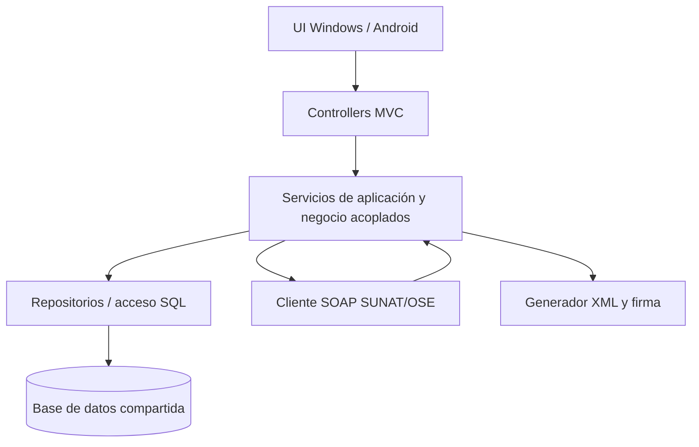
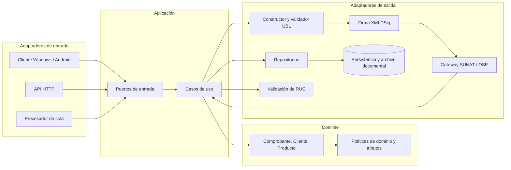

# Hito 4: Arquitectura evolutiva

> **Estado:** propuesta de arquitectura y ADR. El repositorio no contiene implementación MVC; el diagrama MVC es una hipótesis de transición solicitada, no un hallazgo del código.

## 1. Límites de contexto

| Contexto delimitado | Responsabilidad principal | Datos que gobierna |
|---|---|---|
| Facturación | Crear y validar CPE, numeración, representación UBL, firma, envío, CDR y estados. | Comprobantes, líneas, versiones XML, envíos y CDR. |
| Inventario | Entradas/salidas, existencias derivadas, reservas para ventas y saneamiento de movimientos legados. | Productos por almacén, movimientos y saldos. |
| Clientes | Identificación, datos comerciales y consulta/validación de RUC. | Clientes, identificaciones y resultados de validación fechados. |
| Catálogo/tributos | Versiones de productos, unidades y reglas/catálogos con vigencia temporal. | Productos y parámetros de catálogo/norma. |
| Identidad y acceso | Autenticación, autorización y auditoría de usuario. | Usuarios, roles y eventos de seguridad. |

## 2. Monolito MVC inicial (hipótesis)

Este diagrama representa el patrón MVC de partida indicado en el encargo. **POR VERIFICAR:** no se encontró código bajo `/src/` que confirme framework, lenguaje, base de datos o existencia real de estos componentes.

## 3. Arquitectura objetivo Hexagonal / Clean

Dependencias de código apuntan hacia el dominio. Dominio no importa UI, framework, SOAP, almacenamiento ni librerías de interfaz. Los puertos son contratos; los adaptadores implementan su protocolo concreto.

## 4. Equivalencias y desacoplamiento

| MVC inicial (hipótesis) | Target | Cambio de responsabilidad |
|---|---|---|
| Controller con validaciones, cálculo y persistencia | Adaptador HTTP/UI delgado + caso de uso | El adaptador traduce petición/respuesta; políticas y transacción viven en aplicación/dominio. |
| Servicio monolítico que llama SUNAT y escribe SQL | Caso de uso `EmitirComprobante` + puertos `Firma`, `EnvioCpe`, `RepositorioComprobante` | Orquestación explícita; reemplazables SUNAT/OSE, firma y persistencia. |
| Repositorio que filtra lógica de negocio | Puerto de persistencia definido por aplicación/dominio + adaptador SQL | El dominio expresa necesidades; infraestructura decide ORM/SQL y transacciones. |
| DTO HTTP reutilizado como entidad persistente | Comandos/consultas y agregados de dominio separados | Contrato externo evoluciona sin filtrar esquema de BD ni violar invariantes. |
| Llamada síncrona directa al endpoint tributario | Puerto con perfiles síncrono/asíncrono, idempotencia y consulta | Distinguir respuesta final de ticket de procesamiento pendiente. |
| Validación embebida de RUC en formulario | Puerto `ValidadorIdentidadFiscal` | Separar checksum local de consulta registral externa; almacenar fuente y fecha. |

## 5. Evolución hacia servicios futuros

1. **Etapa 1 — Monolito modular:** una unidad de despliegue, módulos Facturación, Inventario, Clientes, Catálogo y Acceso con dependencias internas explícitas y ownership de datos.
2. **Etapa 2 — Desacoplamiento lógico:** contratos versionados, eventos de dominio/outbox, idempotencia, observabilidad por correlación y límites transaccionales entre módulos.
3. **Etapa 3 — Extracción selectiva:** extraer primero el módulo que tenga necesidad independiente comprobada (escalado, ciclo de cambio, disponibilidad o aislamiento de credenciales), preservando API/eventos y migración controlada de datos.
4. **Candidatos:** Facturación (ciclo regulatorio e integración), Inventario (operación/stock), Clientes (identidad y datos compartidos). No se recomienda desplegar microservicios antes de medir volumen, equipo y objetivos de disponibilidad.

No asumir consistencia distribuida como requisito inicial. Para la emisión, usar un registro transaccional durable de estado y outbox/cola cuando se habilite envío asíncrono; evitar emitir dos veces ante timeout mediante clave de idempotencia y consulta de estado.

## 6. ADR-001: stack multiplataforma para MSI y APK

| Campo | Decisión propuesta |
|---|---|
| Estado | **Propuesto; requiere prototipo y aprobación de negocio/operaciones.** |
| Contexto | Entregables requeridos: aplicación Windows instalable como MSI y aplicación Android distribuible como APK. No hay código base ni preferencia de stack en el repositorio. |
| Criterios | Salida Windows MSI y Android APK; soporte oficial y ciclo de actualización; acceso a certificados/almacenamiento seguro; operación offline; interoperabilidad SOAP/XMLDSig; pruebas; habilidad disponible; costos/licencias. |

| Alternativa | Ventajas para el caso | Riesgos / comprobación |
|---|---|---|
| **.NET MAUI** | C# compartido y targets Windows/Android; buena alineación si el equipo conoce .NET; ecosistema Windows para empaquetado. | El empaquetado Windows habitual puede ser MSIX; MSI requiere evaluar cadena de instalador (por ejemplo WiX/paquete empresarial) y actualizar/firmar. Verificar API de certificados y XMLDSig en ambas plataformas, soporte de dependencias SOAP y ciclo de soporte MAUI. |
| **Flutter** | UI compartida Windows/Android; APK Android y ejecutable Windows; plugins y experiencia de UI consistentes. | MSI no es el artefacto Windows de salida por defecto: requiere empaquetador/instalador y estrategia de actualización. Validar plugins de certificados, XMLDSig y SOAP en Windows/Android. |
| **Kotlin Multiplatform** | Reutilización gradual de dominio; ajuste natural a Android y ecosistema JVM para lógica común. | La UI/desktop Windows y distribución MSI requieren validar Compose Multiplatform/toolchain y empaquetado; mayor integración de plataformas y posibles habilidades Kotlin. Verificar dependencias fiscales/criptográficas. |

### Decisión recomendada

Mantener **.NET MAUI como candidato preferente, no decisión final**, si el equipo puede sostener C# y la prueba confirma la generación/actualización de MSI firmado más APK. La razón es que Windows y Android son targets explícitos y el ecosistema Windows facilita integrar un empaquetador MSI. Si ya existe experiencia Flutter/Kotlin o la compatibilidad de XMLDSig/SOAP resulta insuficiente, reevaluar con el mismo prototipo; no elegir solo por compartir UI.

### Consecuencias y prueba de decisión

- Construir un prototipo de riesgo con un XML UBL de prueba: cargar certificado de prueba de forma segura, firmar/verificar XMLDSig, invocar un adaptador sandbox, persistir offline y sincronizar sin duplicados.
- Generar y probar **instalación limpia, actualización, desinstalación y firma de MSI** en Windows y **APK firmado e instalación/actualización** en Android. La disponibilidad exacta de toolchains/versiones y requisitos de distribución son **POR VERIFICAR** al aprobar el stack.
- No almacenar credenciales SOL ni claves privadas en el repositorio, logs, ejemplos o almacenamiento no protegido.

## 7. Restricciones y decisiones abiertas

- Framework, base de datos, topología y modo online/offline: **POR VERIFICAR**; no hay implementación local.
- Canal de recepción SUNAT directo/OSE, contrato, disponibilidad, límites y proceso de certificación: **POR VERIFICAR**.
- Custodia de certificados y claves, rotación, requisitos de certificados y perfil de firma: **POR VERIFICAR** con guía oficial y responsable de seguridad.
- Política para sincronizar inventario y emisión entre dispositivos: **POR VERIFICAR**.